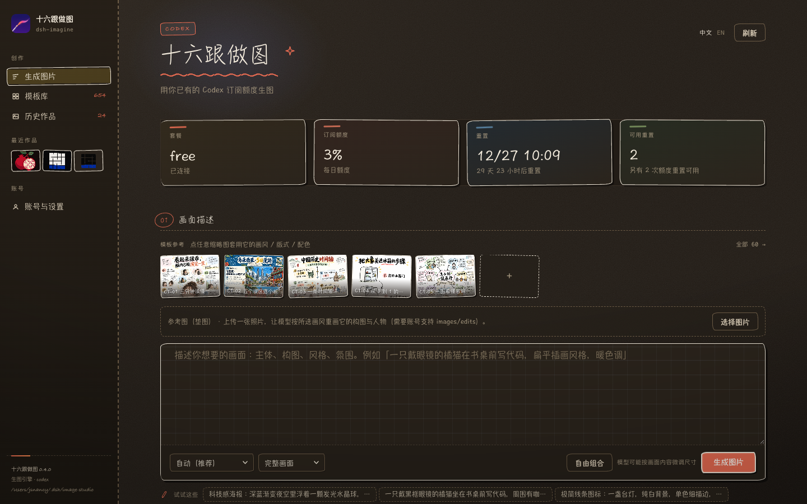
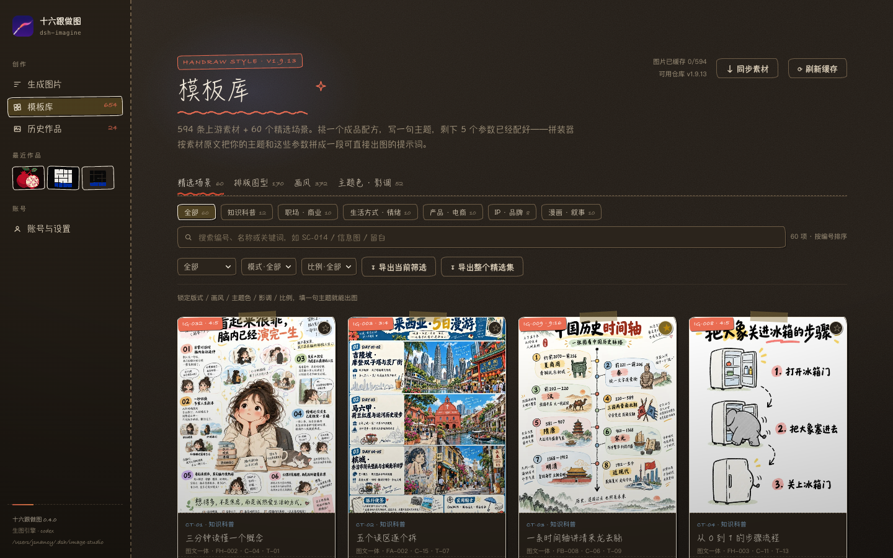
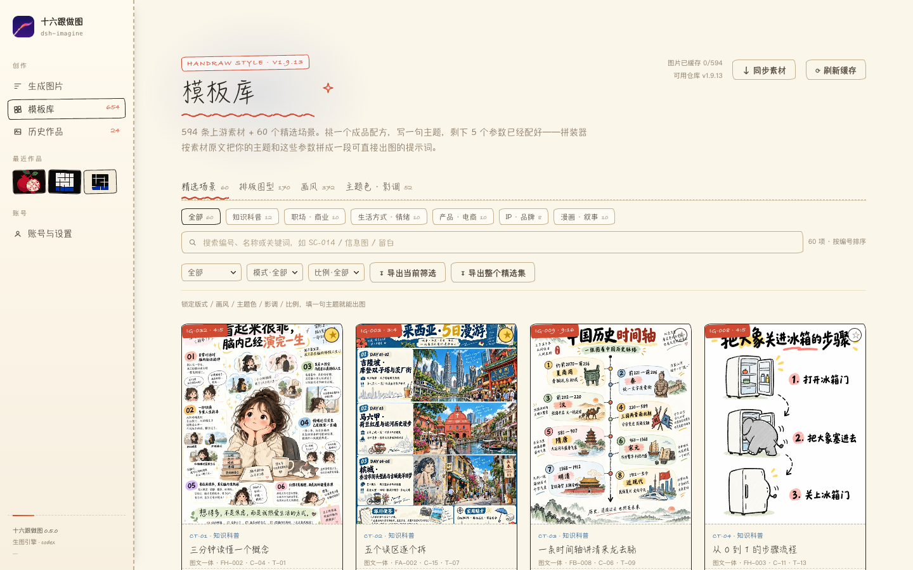
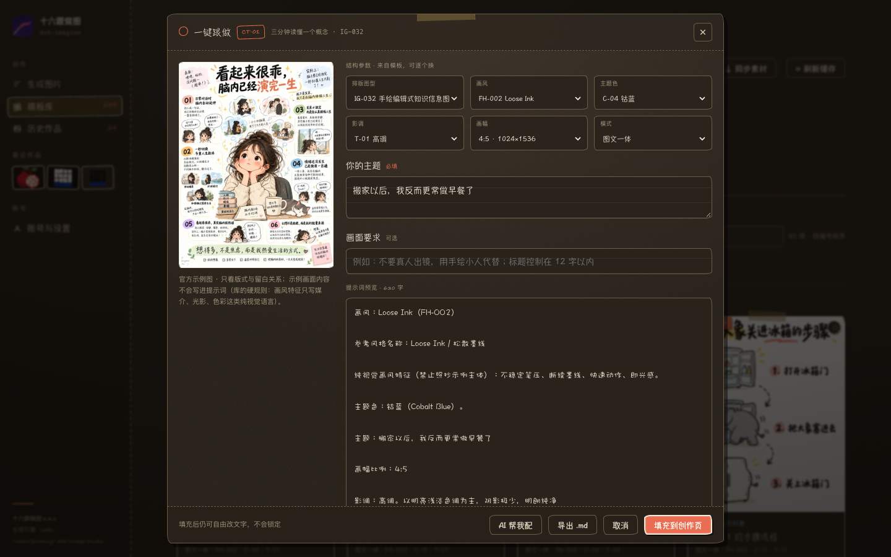
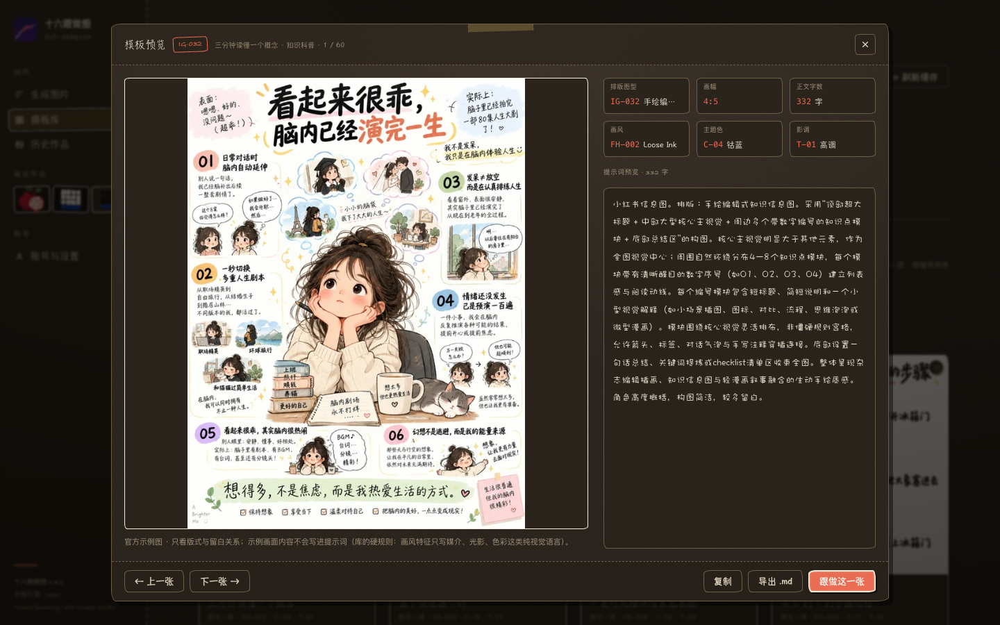
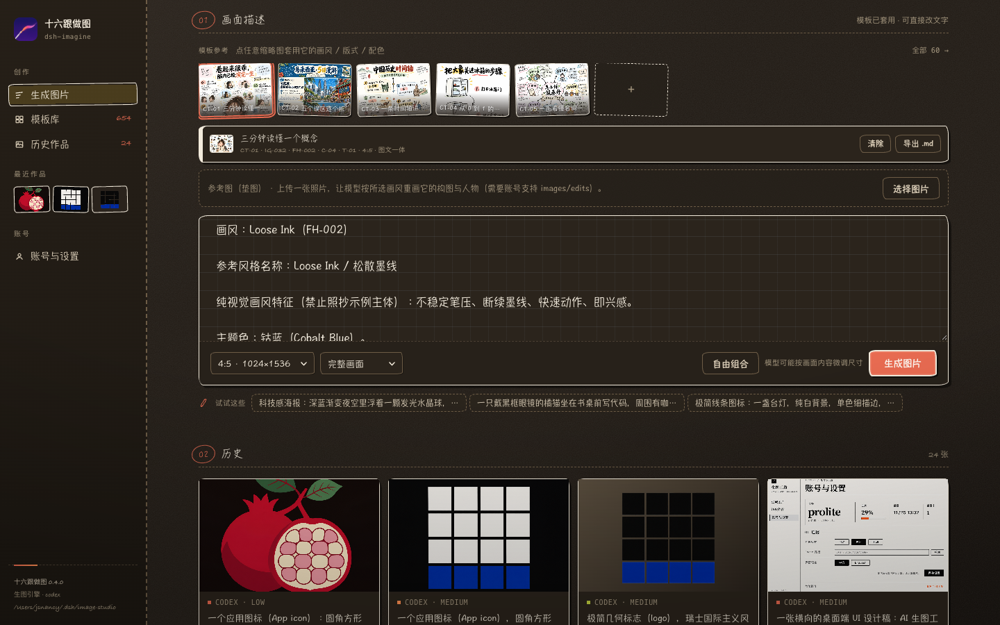
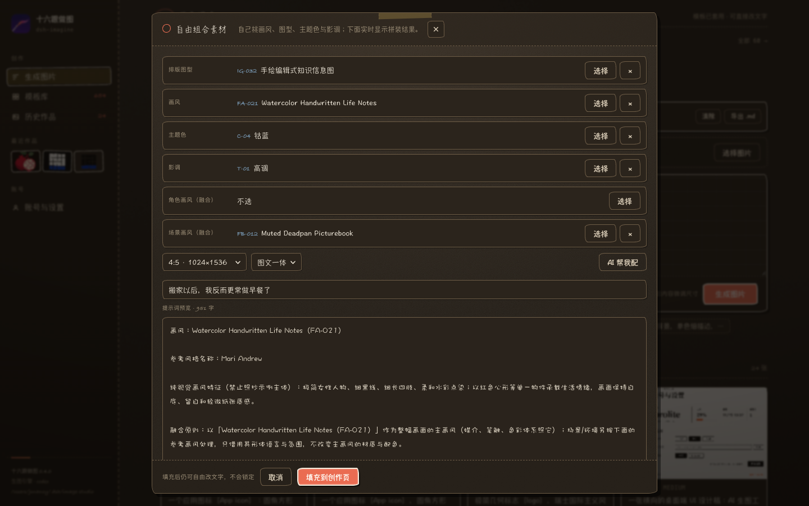
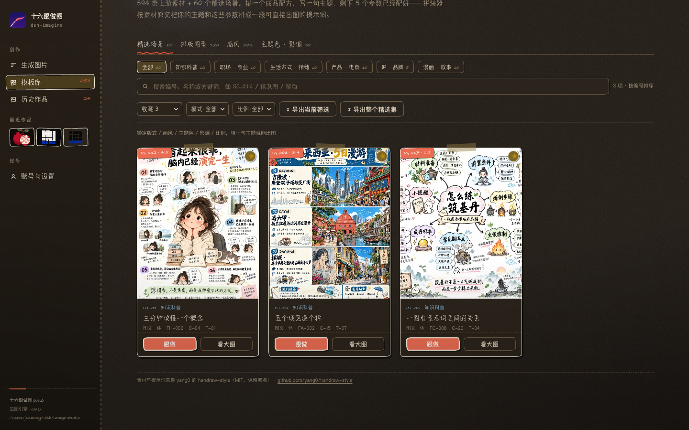
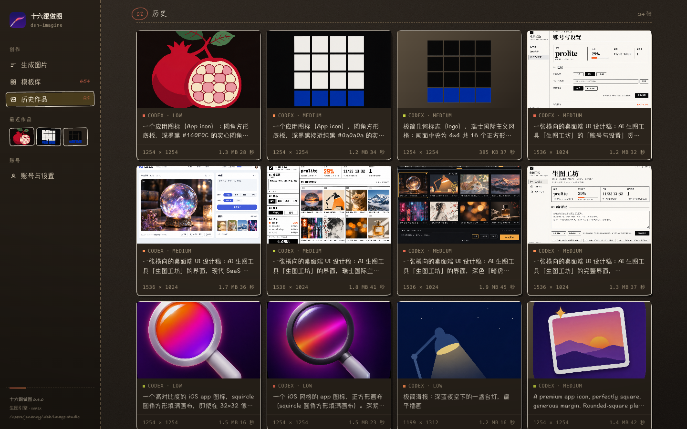
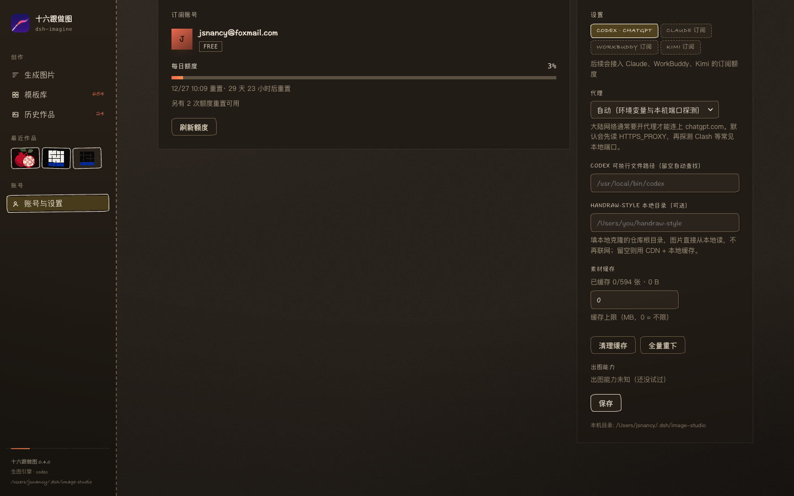

# Template Studio

<p align="center">
  
</p>

A DeepSeek Harness plugin that reads the Codex (ChatGPT subscription) quota already on your machine and draws images with it — no API key, no separate billing.

English · [简体中文](README.zh.md)

- **One panel in the sidebar** — generate image, history, and account & settings in a single column
- **Quota on screen** — plan, weekly usage, reset time and available reset credits, read through the official Codex CLI interface
- **Free-form picking** — choose a style, a layout, a palette and a tone; the composer shows the finished prompt live, with an optional style fusion for character and scene
- **Findable, persistent** — mode/ratio filters, star favourites and recent list survive a reload; export one entry as `.md` (with source and attribution), or batch-export the current filter or the whole curated set to `~/.dsh/image-studio/exports/` and reveal it in Finder
- **Assets on demand** — sync all 594 sample images in the background (3 workers, size cap, clearable) or point the plugin at a local handraw-style checkout and stay fully offline
- **Reference image** — attach a photo and let `images/edits` repaint it in the chosen style; when the endpoint is unavailable the panel says so instead of failing silently
- **AI picks** — the default DSH model only suggests the six ids (layout/style/colour/tone/ratio/mode); the prompt body is still assembled from the upstream text, so the style cannot drift
- **Prompt to PNG** — describe the picture, pick canvas and background, press generate; the result lands on disk and shows up in the panel
- **History** — every render keeps its prompt, size, byte count and elapsed time; copy the prompt, reveal it in Finder, download or delete
- **Two tools for the model** — `image_studio_generate` and `image_studio_quota`
- **Hand-drawn interface** — the panel is a sheet of paper: warm paper with charcoal outlines, handwritten type, marker highlights, tape and slightly rotated sticker cards; the dark theme swaps to dark-roast paper with chalk-white ink (see [Interface style](#interface-style))
- **Theme aware, bilingual** — follows the DSH light/dark theme and switches between 中文 and English
- **Zero npm dependencies** — Node built-ins only; images and history stay on your machine

## Screenshots

| Dark (hand-drawn) | Light (hand-drawn) |
| --- | --- |
|  |  |

| Template library · dark | Template library · light |
| --- | --- |
|  |  |

| Follow a recipe | Preview |
| --- | --- |
|  |  |

| Applied template | Free-form picking |
| --- | --- |
|  |  |

| Favourites | History |
| --- | --- |
|  |  |



## Install

Install the package from the DSH plugin manager (a linked directory is fine for development):

```
plugin_manager: install_bundle, target: <absolute path to this package>
```

A **Template Studio** icon shows up in the sidebar once installed. The host half mounts same-origin HTTP routes under `/image-studio`; the panel uses them to read quota, generate images and fetch them back.

## Access control

The `/image-studio` routes live on the host web server, so every request first passes through `ctx.connection.requestRejection()`: the plugin answers `401` when DSH wants a browser credential and `403` when the request is not an authenticated browser session, and fails closed if the host exposes no such check. The routes are therefore not callable from arbitrary web pages, and the plugin requires DSH `>= 0.2.2-rc.1`, the first release that provides this API.

## Requirements

1. Codex CLI installed and signed in with a ChatGPT account — `codex login status` prints `Logged in using ChatGPT`.
2. `chatgpt.com` reachable. If your network needs a proxy, the plugin auto-detects common local proxy ports (7890/7897/1087/…); you can also set one manually in the panel settings.

## Layout

```
package.json          # dsh.bundle.patch + dsh.client.platform = web
cordis.patch.yml      # inserts the image-studio row
lib/index.js          # host: webServer prefix routes + the two tools + template APIs
lib/client.js         # client: sidebar icon + main panel (React, no JSX)
lib/net.js            # proxy-aware HTTPS (CONNECT tunnel + hand-written HTTP/1.1)
lib/codex.js          # Codex app-server JSON-RPC quota + image requests
lib/providers.js      # provider registry (codex implemented, others reserved)
lib/store.js          # settings, image index, PNG/JPEG/WEBP size sniffing
lib/paths.js          # $DSH_HOME / $CODEX_HOME paths
lib/handraw/catalog.js # template index (594 assets + 60 recipes, gzip + ETag)
lib/handraw/compose.js # prompt composer (follows upstream rules, never rewrites text)
lib/handraw/assets.js  # on-disk asset cache + jsDelivr/raw mirror fetching
lib/skin-handdrawn.css # hand-drawn skin (light paper + dark chalk variables, served at /skin.css)
lib/data/             # build output: catalog.json, curated.json, 60 recipe covers
scripts/build-catalog.mjs # regenerate lib/data from the upstream repo
locale/{zh,en}.json   # title, description and detail doc for the plugin manager
docs/DETAIL.md        # English detail page (DETAIL.zh.md for Chinese)
```

## Development

```bash
node test/net.mjs            # proxy detection and HTTPS tunnelling
node test/codex.mjs          # account and quota
node test/codex.mjs generate # real image generation (spends quota)
node test/host.mjs full      # routes and tools (includes one real render)
node test/templates.mjs      # template index, composer, covers and asset allow-list
node test/templates.mjs --net # additionally verifies real CDN fetches
```

`test/` is for local development only and is not published.

## Interface style

The panel wears a hand-drawn paper skin that swaps material with the DSH theme:

| Theme | Paper | Line | Accent | Feel |
| --- | --- | --- | --- | --- |
| Light | warm paper `#fbf6ea` with grain and a soft vignette | charcoal `#2e2823`, irregular radius borders | cinnabar `#cf4a32` plus marker yellow | four sticky-note tints, tape, slightly rotated sticker cards |
| Dark | dark-roast `#221c16` with coarser grain | chalk `#f3ebdc` | brighter cinnabar `#e8694f` plus dark gold | tape turns dark gold, cards read as dark paper |

Type: HanziPen SC for headings, Hannotate SC for body, Bradley Hand for ids and counters, system sans for small captions so they stay legible, and Wawati SC for long prompt blocks. All of these ship with macOS; on other systems the stack falls back to a system sans-serif — the layout survives, the handwriting gets subtler.

The skin is a single stylesheet, `lib/skin-handdrawn.css`, served by the host at `/image-studio/skin.css` and injected by the panel. It only touches presentation; drop the injection block in `lib/client.js` to get the plain interface back.

## Template data credits

Template content comes from [yang0/handraw-style](https://github.com/yang0/handraw-style) (MIT License with Attribution Requirement, by yang0). This plugin bundles the asset index and 60 recipe covers; other asset images are fetched on demand from jsDelivr / raw.githubusercontent and cached locally. Prompt bodies are assembled from upstream text without rewriting. Exported `.md` files carry the source and license notice.

## License

MIT. Template assets and prompt text are copyright [handraw-style](https://github.com/yang0/handraw-style) / yang0, used under the MIT with attribution requirement.
