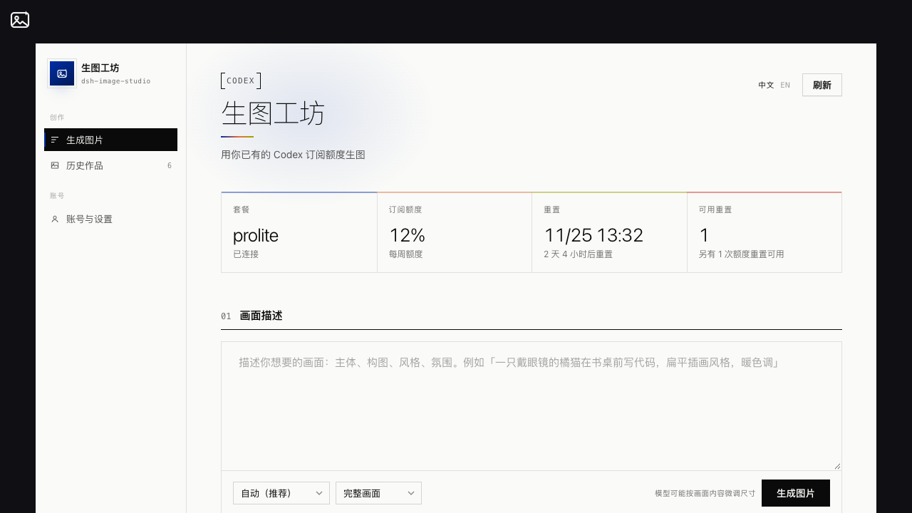

# Image Studio

<p align="center">
  
</p>

A DeepSeek Harness plugin that reads the Codex (ChatGPT subscription) quota already on your machine and draws images with it — no API key, no separate billing.

English · [简体中文](README.zh.md)

- **One panel in the sidebar** — generate image, history, and account & settings in a single column
- **Quota on screen** — plan, weekly usage, reset time and available reset credits, read through the official Codex CLI interface
- **Prompt to PNG** — describe the picture, pick canvas and background, press generate; the result lands on disk and shows up in the panel
- **History** — every render keeps its prompt, size, byte count and elapsed time; copy the prompt, reveal it in Finder, download or delete
- **Two tools for the model** — `image_studio_generate` and `image_studio_quota`
- **Theme aware, bilingual** — follows the DSH light/dark theme and switches between 中文 and English
- **Zero npm dependencies** — Node built-ins only; images and history stay on your machine

## Screenshots

| Dark | Light |
| --- | --- |
|  |  |


## Install

Install the package from the DSH plugin manager (a linked directory is fine for development):

```
plugin_manager: install_bundle, target: <absolute path to this package>
```

A **Image Studio** icon shows up in the sidebar once installed. The host half mounts same-origin HTTP routes under `/image-studio`; the panel uses them to read quota, generate images and fetch them back.

## Access control

The `/image-studio` routes live on the host web server, so every request first passes through `ctx.connection.requestRejection()`: the plugin answers `401` when DSH wants a browser credential and `403` when the request is not an authenticated browser session, and fails closed if the host exposes no such check. The routes are therefore not callable from arbitrary web pages, and the plugin requires DSH `>= 0.2.2-rc.1`, the first release that provides this API.

## Requirements

1. Codex CLI installed and signed in with a ChatGPT account — `codex login status` prints `Logged in using ChatGPT`.
2. `chatgpt.com` reachable. If your network needs a proxy, the plugin auto-detects common local proxy ports (7890/7897/1087/…); you can also set one manually in the panel settings.

## Layout

```
package.json          # dsh.bundle.patch + dsh.client.platform = web
cordis.patch.yml      # inserts the image-studio row
lib/index.js          # host: webServer prefix routes + the two tools
lib/client.js         # client: sidebar icon + main panel (React, no JSX)
lib/net.js            # proxy-aware HTTPS (CONNECT tunnel + hand-written HTTP/1.1)
lib/codex.js          # Codex app-server JSON-RPC quota + image requests
lib/providers.js      # provider registry (codex implemented, others reserved)
lib/store.js          # settings, image index, PNG/JPEG/WEBP size sniffing
lib/paths.js          # $DSH_HOME / $CODEX_HOME paths
locale/{zh,en}.json   # title, description and detail doc for the plugin manager
docs/DETAIL.md        # English detail page (DETAIL.zh.md for Chinese)
```

## Development

```bash
node test/net.mjs            # proxy detection and HTTPS tunnelling
node test/codex.mjs          # account and quota
node test/codex.mjs generate # real image generation (spends quota)
node test/host.mjs full      # routes and tools (includes one real render)
```

`test/` is for local development only and is not published.

## License

MIT
