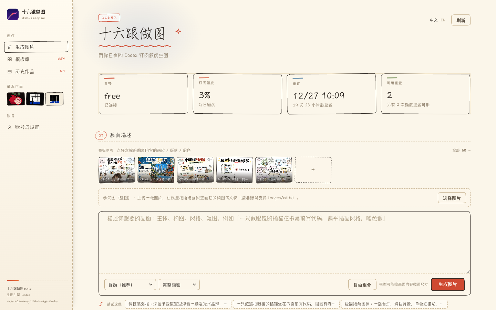
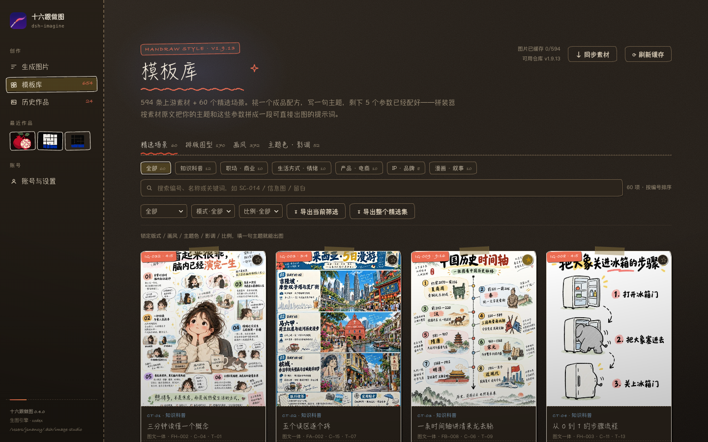
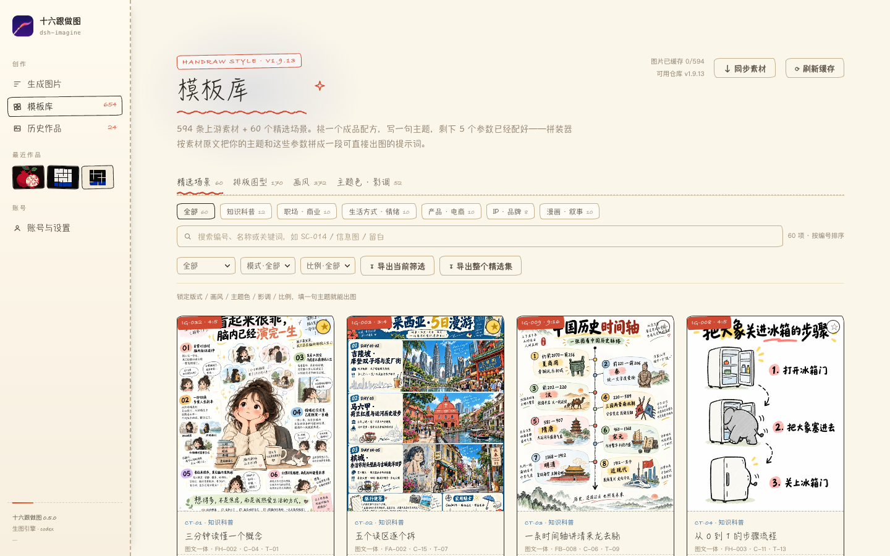
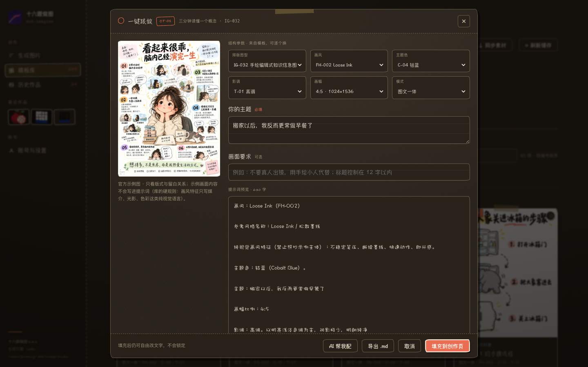
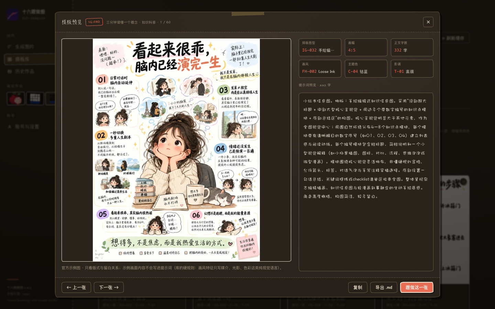
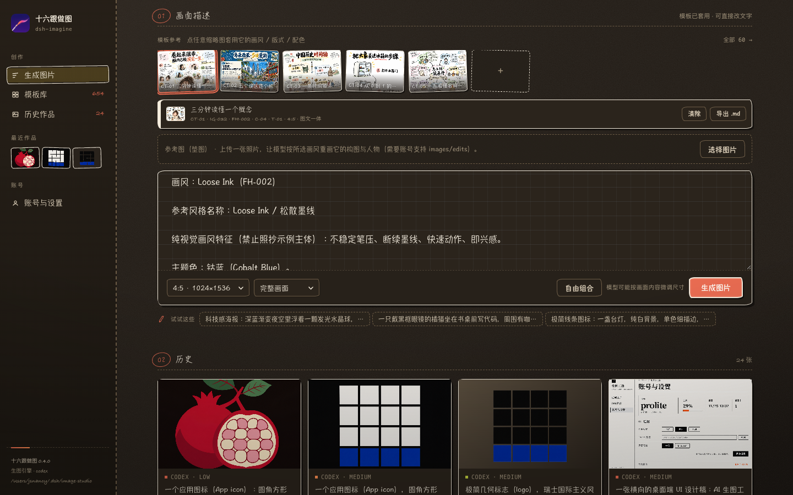
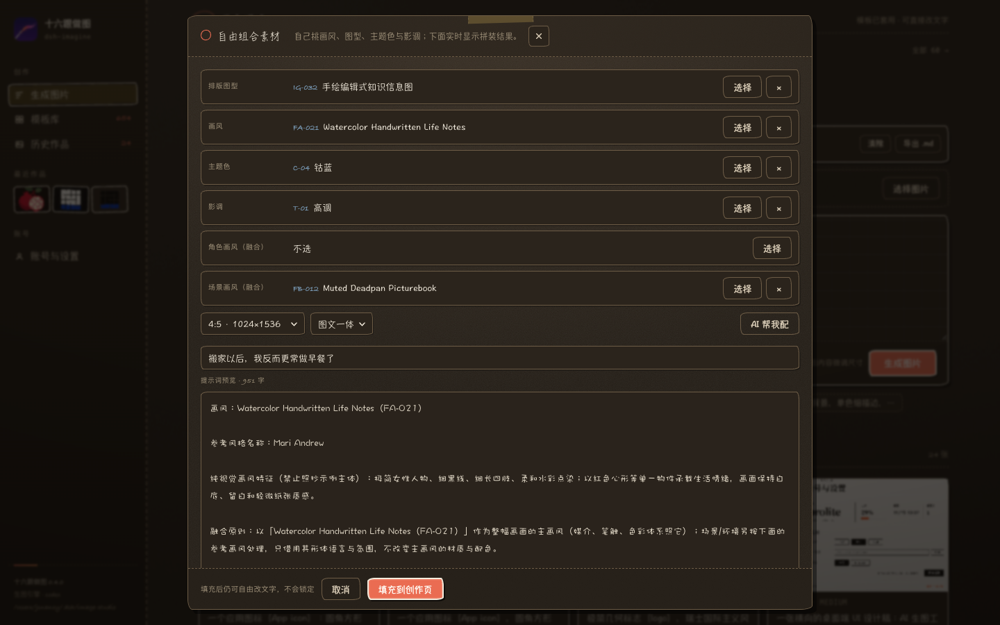
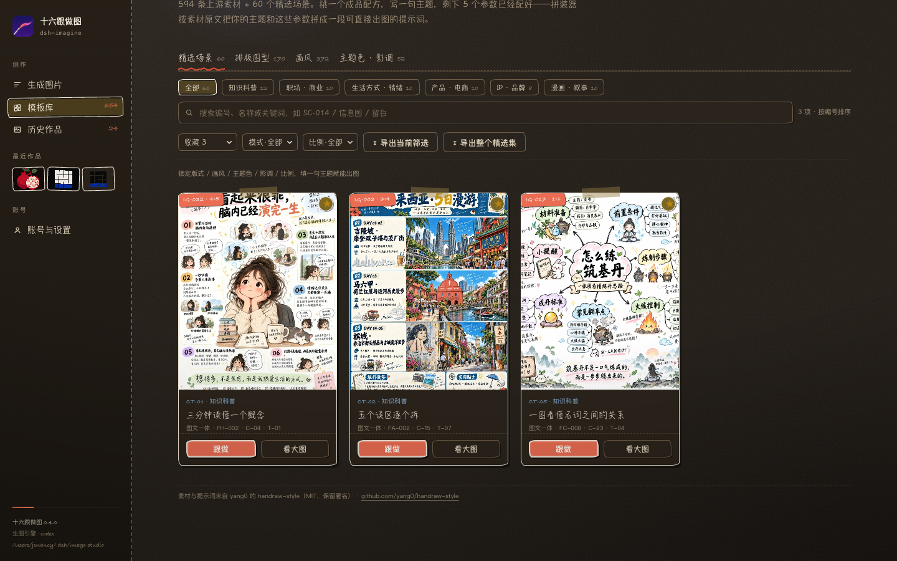
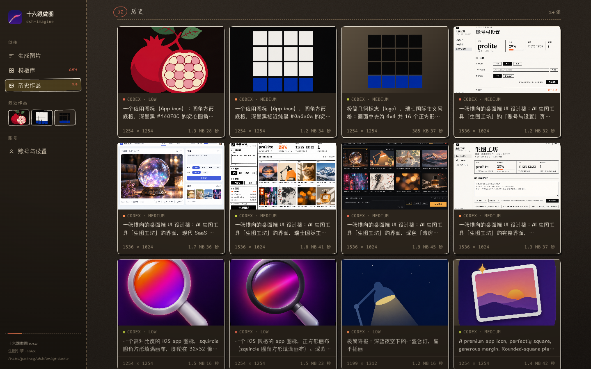
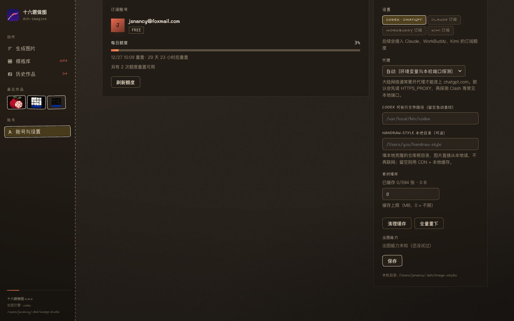

# 十六跟做图

<p align="center">
  
</p>

DeepSeek Harness 插件：读取本机已有的 Codex（ChatGPT 订阅）额度，并用这份订阅的生图能力出图。不需要 API key，也不额外计费。

[English](README.md) · 简体中文

- **侧栏一个独立面板** —— 生成图片、历史作品、账号与设置收在同一列
- **额度直接显示** —— 套餐、本周已用百分比、重置时间与可用重置卡，走 Codex CLI 的官方接口读取
- **模板库一键跟做** —— 内置 [handraw-style](https://github.com/yang0/handraw-style) 手绘提示词库：594 条上游素材 + 60 个成品场景配方，锁定版式/画风/主题色/影调/比例，只写一句主题就能拼出可直接出图的提示词
- **自由组合素材** —— 画风 / 排版图型 / 主题色 / 影调各挑一个，实时看到拼好的提示词；还能开「风格融合」，让角色与场景各用一套画风
- **找得到、留得住** —— 模式/比例二级筛选、收藏星标、最近使用，刷新后还在；选中一套可以一键导出 `.md`（带来源与署名），也能把当前筛选或整个精选集批量导出到 `~/.dsh/image-studio/exports/` 并自动在访达里定位
- **素材随手可用** —— 594 张素材图后台 3 并发同步到本机（可设上限、可清理），也可以直接指向本地克隆的 handraw-style 仓库目录，完全离线
- **参考图（垫图）** —— 上传一张照片，交给 `images/edits` 按所选画风重画；接口不可用时面板会明说，不会静默失败
- **AI 帮我配** —— 让 DSH 默认模型只推荐「图型/画风/主题色/影调/比例/模式」这 6 个编号，提示词正文仍由拼装器按上游原文拼，避免风格漂移
- **一句话出图** —— 写画面描述、选画布与背景、点生成；结果落成 PNG 存到本机并显示在面板里
- **留下历史** —— 每张图都记着提示词、尺寸、体积与耗时，可复制描述、在访达中显示、下载或删除
- **两个工具给模型调用** —— `image_studio_generate`、`image_studio_quota`
- **手绘风界面** —— 面板本身就是一张纸：暖白纸底配炭笔描边、手写字体、马克笔高亮、胶带与微旋转的贴纸卡；切到深色主题会换成「深咖啡纸 + 粉笔白线」的一套，见[界面风格](#界面风格)
- **跟随主题、中英双语** —— 跟随 DSH 浅色/深色主题，面板可在中文与 English 之间切换
- **零 npm 依赖** —— 只用 Node 内置模块；图片与历史只存本机

## 界面

| 深色（手绘） | 浅色（手绘） |
| --- | --- |
|  |  |

| 模板库 · 深色 | 模板库 · 浅色 |
| --- | --- |
|  |  |

| 一键跟做 | 看大图 |
| --- | --- |
|  |  |

| 已套用模板 | 自由组合素材 |
| --- | --- |
|  |  |

| 收藏筛选 | 历史作品 |
| --- | --- |
|  |  |



## 安装

在 DSH 的插件管理里安装本包（linked 目录安装即可用于开发）：

```
plugin_manager: install_bundle, target: <本包绝对目录>
```

安装后侧栏出现「十六跟做图」图标。Host 半在 `/image-studio` 挂同源 HTTP 路由，面板通过它读取额度、生图、取图。

## 访问控制

`/image-studio` 路由挂在宿主 web server 上，每个请求都先过 `ctx.connection.requestRejection()`：需要浏览器凭证时返回 `401`，不是已认证的浏览器会话时返回 `403`；宿主没有提供这项检查时插件一律拒绝。因此这些路由无法被普通网页直接调用，插件要求 DSH `>= 0.2.2-rc.1`（首个提供该 API 的版本）。

## 前置条件

1. 本机装了 Codex CLI，并且已经用 ChatGPT 账号登录：`codex login status` 显示 `Logged in using ChatGPT`。
2. 能连通 `chatgpt.com`。需要代理时插件会自动探测常见的本地代理端口（7890/7897/1087/…），也可以在面板设置里手动指定。

## 结构

```
package.json          # dsh.bundle.patch + dsh.client.platform = web
cordis.patch.yml      # 插入 image-studio 一行
lib/index.js          # Host：webServer prefix 路由 + 两个工具 + 模板库接口
lib/client.js         # Client：侧栏图标 + 主面板（React，无 JSX）
lib/net.js            # 代理感知 HTTPS（CONNECT 隧道 + 手写 HTTP/1.1）
lib/codex.js          # Codex app-server JSON-RPC 额度 + 生图请求
lib/providers.js      # provider 注册表（codex 已实现，其余预留）
lib/store.js          # 设置、图片索引、PNG/JPEG/WEBP 尺寸嗅探
lib/paths.js          # $DSH_HOME / $CODEX_HOME 路径
lib/handraw/catalog.js # 模板索引（594 素材 + 60 场景，gzip + ETag）
lib/handraw/compose.js # 提示词拼装器（按上游规则拼接，不改写原文）
lib/handraw/assets.js  # 素材图磁盘缓存 + jsDelivr/raw 双镜像按需拉取
lib/skin-handdrawn.css # 手绘风皮肤（浅色纸 + 深色黑板两套变量，Host 在 /skin.css 提供）
lib/data/             # 构建产物：catalog.json、curated.json、60 张场景封面
scripts/build-catalog.mjs # 从上游仓库重新生成 lib/data（开发用）
locale/{zh,en}.json   # 插件管理里显示的标题、描述与详情文档
docs/DETAIL.zh.md     # 中文详情页（英文见 DETAIL.md）
```

## 开发自测

```bash
node test/net.mjs            # 代理探测与 HTTPS 隧道
node test/codex.mjs          # 账号、额度
node test/codex.mjs generate # 真实生图（会消耗额度）
node test/host.mjs full      # 路由与工具（含一次真实生图）
node test/templates.mjs      # 模板索引、拼装器、封面与素材白名单
node test/templates.mjs --net # 额外验证 CDN 真实拉取
```

`test/` 只在本地开发使用，不随包发布。

## 界面风格

面板是一套「手绘纸」皮肤，随 DSH 主题自动换物质：

| 主题 | 底 | 线 | 强调 | 手感 |
| --- | --- | --- | --- | --- |
| 浅色 | 暖白纸 `#fbf6ea` + 纸纹噪点 + 边缘暗角 | 炭笔 `#2e2823`，不规则圆角边框 | 朱砂 `#cf4a32` + 马克笔黄 | 便签四色、胶带、贴纸卡微旋转 |
| 深色 | 深咖啡纸 `#221c16` + 更粗的颗粒 | 粉笔白 `#f3ebdc` | 亮朱砂 `#e8694f` + 暗金 | 胶带变暗金，卡片像深色纸片 |

字体：标题用翩翩体（HanziPen SC）、正文用手札体（Hannotate SC）、编号与计数用 Bradley Hand，注释小字退回系统字体保证清晰；长段提示词用娃娃体（Wawati SC）以便阅读。这些都是 macOS 自带字体，缺字体的系统会回落到系统无衬线体——版式不变，手写感会弱一些。

皮肤实现为一份独立样式表 `lib/skin-handdrawn.css`，由 Host 在 `/image-studio/skin.css` 提供、面板注入。它只改观感，不改 DOM 结构与业务逻辑；想回到朴素界面，删掉 `lib/client.js` 里注入 `skin.css` 的那一段即可。

## 模板库数据来源

模板库内容来自 [yang0/handraw-style](https://github.com/yang0/handraw-style)（MIT License with Attribution Requirement，作者 yang0）。本插件内置其素材索引与 60 张场景封面，其余素材图在使用时按需从 jsDelivr / raw.githubusercontent 拉取并缓存在本机；提示词正文按上游规则原样拼接，不改写。导出的 `.md` 会带上来源与许可声明。

## 许可

MIT。模板库素材与提示词文本版权归 [handraw-style](https://github.com/yang0/handraw-style) 作者 yang0 所有，按 MIT + 署名要求使用。
